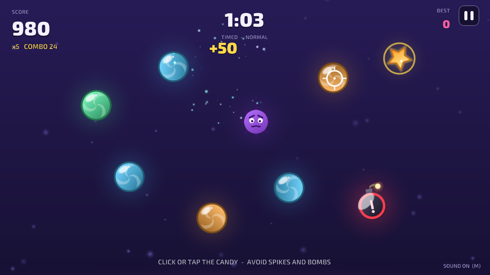
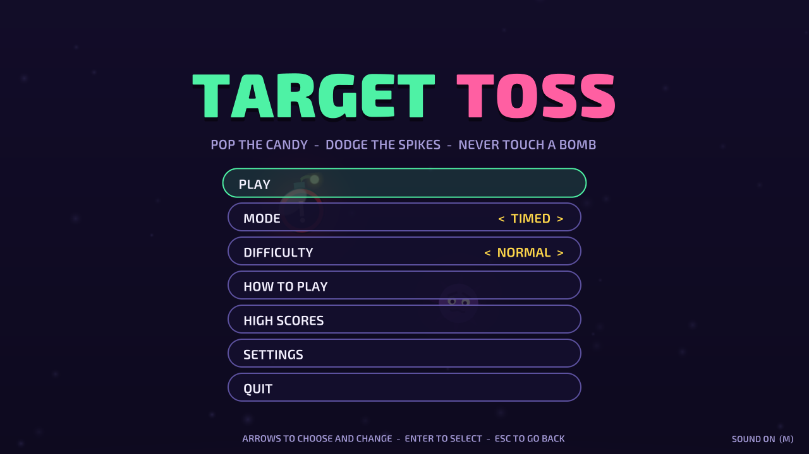
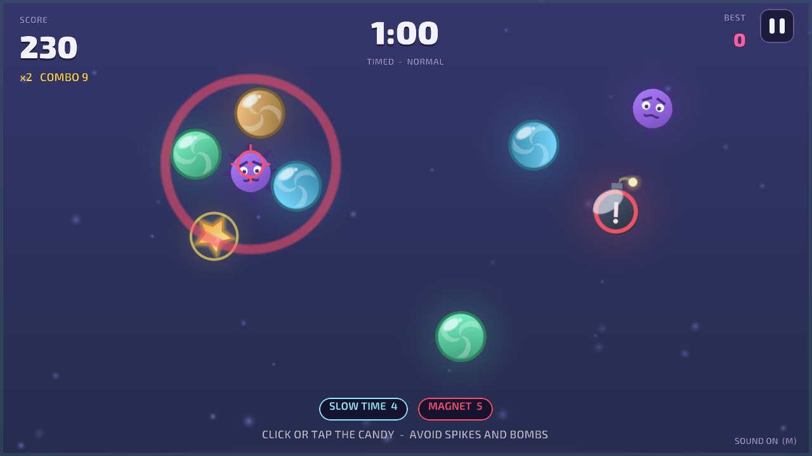
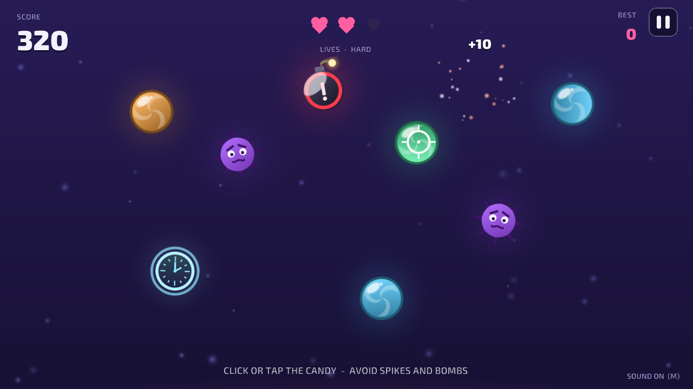
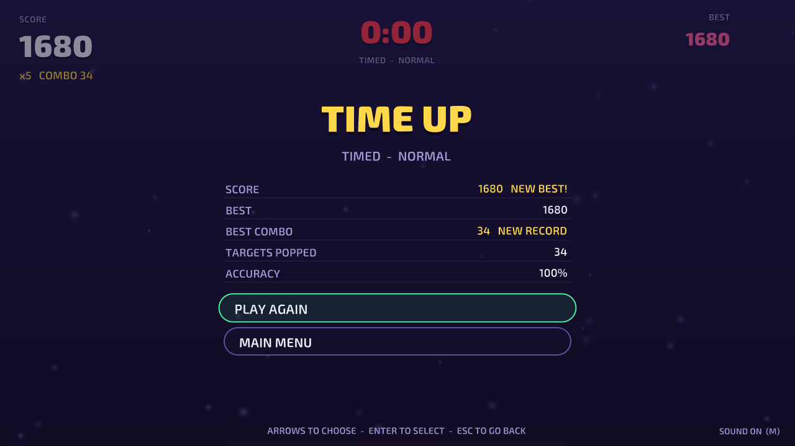
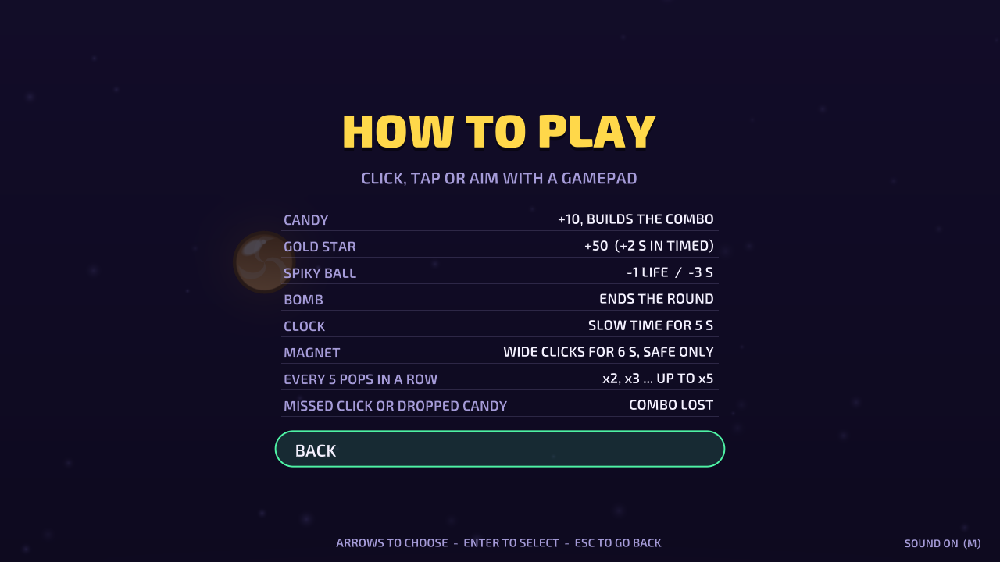
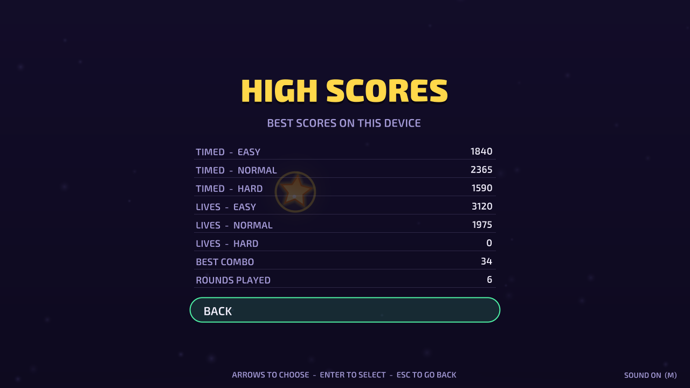
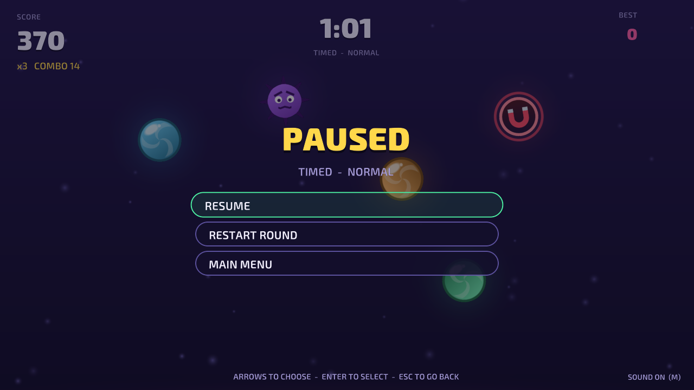

# Target Toss

A candy arcade game built with Unity: pop the candy tossed up from below the screen, chain
pops into a combo multiplier, leave the spiky balls alone and never touch a bomb. Play a
60-second Timed round or a three-life Lives round on Easy, Normal or Hard, with a mouse, a
touch screen or a gamepad.

It started in 2021 as my take on **Prototype 5 ("Clicky Mouse") from Unit 5 of the Unity Learn
Junior Programmer pathway**, and was rebuilt on that idea as an original game (see
[Where it came from](#where-it-came-from)).



| | |
|---|---|
|  |  |
|  |  |
|  |  |
|  | |

## Play it

- **In your browser:** [trysac.github.io/Unit-5-User-Interface](https://trysac.github.io/Unit-5-User-Interface/)
- **On itch.io:** [trysac.itch.io/target-toss](https://trysac.itch.io/target-toss)
- **Get the code:** fork this repository, or clone it:

  ```bash
  git clone https://github.com/Trysac/Unit-5-User-Interface.git
  ```

## Run it

1. Install **Unity 6000.3.27f1 (Unity 6 LTS)** with Unity Hub (add the Windows or Web build
   support module if you want to build players).
2. In Unity Hub choose **Add → Add project from disk** and select the repository folder.
3. Open `Assets/Scenes/Main.unity` and press **Play**.

To build a player use **File → Build Profiles** (Windows or Web), or build from a terminal into
a folder outside the repository:

```bash
Unity -batchmode -quit -projectPath . -executeMethod TargetToss.EditorTools.ProjectBuilder.BuildWebGL -buildOutput ../build/web
```

(`BuildWindows` works the same way.) The WebGL build is uncompressed, so it runs from any
static host such as GitHub Pages.

The tests run from **Window → General → Test Runner** (EditMode and PlayMode), or from a terminal:

```bash
Unity -batchmode -projectPath . -runTests -testPlatform EditMode -testResults results.xml
Unity -batchmode -projectPath . -runTests -testPlatform PlayMode -testResults playmode.xml
```

The scene, the glow material, the font atlases, the icon and the player settings are generated
by **Target Toss → Regenerate Art, Scene and Player Settings** (`ProjectBuilder.SetUpProject`),
and the sounds by `python tools/audio/build.py` (needs ffmpeg). The README screenshots come from
an opt-in hook: run a built player with `-screenshot <folder>` (optionally
`-scenario title,play,powers,lives,pause,results,howto,records`), or, without a player,
`Unity -batchmode -projectPath . -executeMethod TargetToss.EditorTools.ProjectBuilder.CaptureScreenshots -screenshot <folder>`.

## Controls

| Action | Mouse and keyboard | Touch | Gamepad |
|---|---|---|---|
| Pop a target | Left click | Tap (several fingers work) | A, a trigger or the right shoulder button at the cursor |
| Aim | Move the mouse | — | Either stick or the d-pad moves the cursor |
| Pause | Esc or P | The ❚❚ button at the top right | Start |
| Menus | ↑ / ↓ to choose, ← / → to change a value, Enter to select, Esc to go back; or click a row | Tap a row | D-pad or stick, A to select, B to go back |
| Mute | M | Settings → Sound | Settings → Sound |

## How it plays

- **Targets.** Candy scores 10 points; a gold star scores 50 (and adds 2 seconds in Timed
  mode). A spiky ball costs a life in Lives mode or 3 seconds in Timed mode. A bomb ends the
  round in either mode.
- **Combo.** Every safe pop adds to the combo, and every 5 pops in a row raise the multiplier,
  from x1 up to x5. A click that hits nothing, a spiky ball or candy that falls back out of
  the screen breaks it.
- **Modes.** Timed: as many points as you can in 60 seconds. Lives: no clock, three lives, and
  every candy you let fall costs one.
- **Difficulty** sets how often targets are tossed (Easy starts at one every 1.05 s and tightens
  to 0.6 s over the first minute; Hard goes from 0.7 s to 0.3 s), how hard they are thrown, the
  mix (bombs are 3% of single tosses on Easy, 6% on Normal and 9% on Hard; the second target of a pair is never a bomb) and how often two fly
  at once.
- **Power-ups.** The clock slows every target to 45% speed for 5 seconds (the round clock keeps
  real time). The magnet turns every click into a wide pull for 6 seconds that collects all
  the candy, stars and power-ups near it and never a hazard. No new power-up is tossed while
  one is running.
- **High scores** on the device (PlayerPrefs): the best score for each of the six mode and
  difficulty pairs, the best combo and the rounds played. The settings (mode, difficulty,
  volume, sound, screen shake and gamepad cursor speed) are saved too.

## What I learned / technically interesting

- **Rules without the engine.** Tossing, flight, clicks, combos, both modes, power-ups, settings
  and high scores live in `Assets/Scripts/Core`, a plain C# assembly with no Unity references,
  covered by 40 deterministic EditMode tests: a seeded xorshift generator makes every round
  repeatable, and the tests check things like "every toss peaks inside the screen and falls
  back out" and "the mix follows the difficulty weights over 20,000 picks". 9 PlayMode tests
  drive the real scene: title, start, scoring, game over, lives, pause, restart, power-ups and
  settings.
- **Bugs found with tests first.** The 2021 version set the spawn interval to
  `difficulty / 3` with integer division, so Easy and Normal spawned a target every frame and
  Hard one per second; its game-over text pointed at objects in the menu scene, which no longer
  exist once the game scene loads, so game over threw an exception; and the manager re-activated
  the round every frame, so targets kept coming after game over. PlayMode tests on the
  original scenes reproduced each one before it was fixed.
- **Game feel.** Floating score that grows with the multiplier, particle bursts in the target's
  colour, a few milliseconds of hit-stop per pop (about a fifth of a second for a bomb),
  trauma-based screen shake, a combo banner, and the music bending down while slow time runs.
- **One input path for three devices.** The Input System reads the mouse, every new touch and a
  virtual gamepad cursor into the same list of clicks, so a round never knows what clicked it.
  The reticle replaces the system pointer during a round.
- **Everything is generated.** Every sprite (candy, stars, spiky balls, bombs, power-up badges,
  the reticle, hearts) is drawn in code at start-up from distance functions; the scene, the
  material, the font atlases, the app icon and the player settings come from an editor script
  (`ProjectBuilder.cs`); the music and sound effects come from a tiny Python synthesizer
  (`tools/audio`). The HUD and menus are UI Toolkit.

## Where it came from

The first version followed Unity Learn's Junior Programmer pathway, Unit 5 "User Interface"
(lessons 5.1 to 5.4, "Clicky Mouse"): food and skull models tossed up with physics, a score,
a game-over screen and three difficulty buttons, in Unity 2020.3. In 2026 it was upgraded to
Unity 6, its bugs were reproduced in tests and fixed, its rules were extracted into a tested
core, and the idea was grown into this game. The course's models, textures, particles and
materials were removed, because Unity Learn content has no licence to be redistributed in a
public repository; everything you see now was made for this project, except the two Exo 2
fonts.

## Credits

- **Base idea:** Unity Learn, Junior Programmer pathway, Unit 5 "User Interface" (Prototype 5).
  None of its assets remain.
- **Fonts:** Exo 2 Black and Exo 2 SemiBold by Natanael Gama, licensed under the
  [SIL Open Font License 1.1](Assets/Fonts/OFL.txt); they ship unmodified in `Assets/Fonts`.
- Everything else (code, sprites, sounds, music, icon) was made for this project. See
  [CREDITS.md](CREDITS.md).

## License

The code and the generated assets are under the [MIT License](LICENSE). The Exo 2 fonts keep
their own SIL Open Font License (`Assets/Fonts/OFL.txt`).
